<div align="center">

<!-- hero: monochrome ASCII portrait (types in) beside a neofetch-style info
     panel. regenerate portrait: python scripts/prep_photo.py <photo> &&
     python scripts/make_ascii_svg.py ; info panel: python scripts/make_info_card.py -->

<!-- animated contribution graph: real data, boxes pop in cell by cell
     (regenerated daily by .github/workflows/update-profile-art.yml) -->

<h3><code>arv1ndofficial@github ~ $ ./contributions.sh</code></h3>



<br>
<br>

<h3><code>arv1ndofficial@github ~ $ whoami</code></h3>

<table>
<tr>
<td valign="top"></td>
<td valign="top"></td>
</tr>
</table>

<br>

<h3><code>arv1ndofficial@github ~ $ ./links.sh</code></h3>

<p><b>Senior Data &amp; AI Engineer &middot; Lakehouse Architect &middot; Applied GenAI / Agentic Systems</b></p>

[](https://arv1ndofficial.github.io)
[](https://www.linkedin.com/in/aravindanramesh/)
[](https://arv1ndofficial.github.io/terminal)
[](mailto:aravindanramesh910@gmail.com)

<br>
<br>

<h3><code>arv1ndofficial@github ~ $ cat /etc/system-stats.env</code></h3>

</div>

```bash
# Production Telemetry & Platform Scale
UPTIME="5+ Years in High-Volume Production Engineering (Fintech & Telecom Scale)"
PLATFORM_SCALE="Multi-TB Lakehouse Storage · Millions of Daily Events · Sub-Second Streaming"
LAKEHOUSE_CORE="Apache Iceberg + Spark + Trino + Nessie Catalog on AWS EKS"
CDC_HISTORY="SCD Type 1 & Type 2 Streaming Audits · Zero-Downtime Schema Evolution"
AGENTIC_AI="Autonomous ETL Workflows via MCP (Model Context Protocol) & RAG"
ENGINEERING_LEAD="Technical Lead for 5-Engineer High-Throughput Data Platform Team"
CREDENTIALS="Flink Streaming Engineer (Confluent) · Azure DP-203 · AWS SAA · Linux LE-01"
```

<div align="center">
<br>

<h3><code>arv1ndofficial@github ~ $ neofetch --skills</code></h3>

</div>

#### 🏛️ Distributed Lakehouse & Storage Engines
<p align="center">
  
  
  
  
  
  
  
</p>

#### ⚡ Real-Time Streaming & Event-Driven Processing
<p align="center">
  
  
  
  
</p>

#### 🤖 AI, Agentic Workflows & Vector Systems
<p align="center">
  
  
  
  
  
  
</p>

#### ☁️ Cloud, Orchestration & DevOps
<p align="center">
  
  
  
  
  
  
  
</p>

#### 💻 Core Languages & Analytical Backends
<p align="center">
  
  
  
  
  
  
</p>

<div align="center">
<br>

<h3><code>arv1ndofficial@github ~ $ ls -la /projects/featured/</code></h3>

</div>

```
total 4
drwxr-xr-x  5 arv1nd  staff   160 Nov 14 2026 ./
drwxr-xr-x  3 arv1nd  staff    96 Nov 14 2026 ../
-rwxr-xr-x  1 arv1nd  staff  4096 prod  Goodcabs-Transportation-Lakehouse/
-rwxr-xr-x  1 arv1nd  staff  4096 prod  EKS-Iceberg-Nessie-OpenLakehouse/
-rwxr-xr-x  1 arv1nd  staff  4096 prod  Agentic-MCP-Autonomous-Data-Platform/
-rwxr-xr-x  1 arv1nd  staff  4096 prod  Walmart-Airflow-dbt-Analytics-Pipeline/
```

| Flagship Project | Architecture & Stack | Description & Engineering Impact |
|:---|:---|:---|
| **[Goodcabs Lakehouse](https://github.com/arv1ndofficial/transport-proj-dbx)** | `Databricks` `Spark DLT` `Auto Loader` `Delta Lake` `SCD-1 CDC` | Production medallion lakehouse across 10 cities with automated schema drift handling, declarative CDC, dynamic calendar dimensions, and `@dp.expect` quality gates. |
| **EKS Open Lakehouse** | `Apache Iceberg` `Spark on EKS` `Trino` `Nessie Catalog` `AWS S3` | Multi-tenant lakehouse with hot/cold partition pruning and Git-like Iceberg metadata commits via Nessie, slashing query latency and AWS storage spend. |
| **Agentic MCP Platform** | `Model Context Protocol (MCP)` `LangGraph` `ChromaDB` `Ollama` `Airflow` | Standardized agent-to-lakehouse bridge allowing LLMs to safely trigger declarative workflows, query vector indexes, and run automated audits. |
| **[Walmart ELT Analytics](https://github.com/arv1ndofficial/Walmart_Airflow_DBT_Project)** | `Apache Airflow` `dbt` `PostgreSQL` `Docker` `Data Quality` | Production ELT pipelines orchestrating modular dbt transformations with automated schema tests, lineage graphs, and incremental marts. |

<div align="center">
<br>

<h3><code>arv1ndofficial@github ~ $ ./github-metrics.sh</code></h3>

<p align="center">
  
  &nbsp;
  
</p>

<br>

<h3><code>arv1ndofficial@github ~ $ curl -X POST https://connect.arv1nd.dev/v1/ping</code></h3>

<p>
  <b>Open for Remote Senior Data &amp; AI Engineering Opportunities Worldwide</b><br>
  Specializing in distributed lakehouses, real-time streaming engines, and autonomous agentic workflows.
</p>

[](https://arv1ndofficial.github.io)
[](https://arv1ndofficial.github.io/terminal)
[](https://www.linkedin.com/in/aravindanramesh/)
[](mailto:aravindanramesh910@gmail.com)

<br>

```bash
# Instant live terminal resume session:
curl -sL https://arv1ndofficial.github.io/terminal
```

</div>
